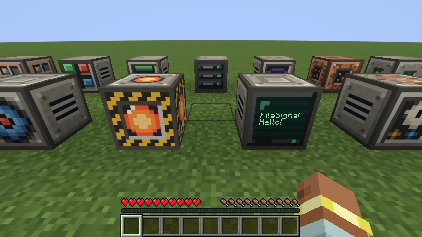
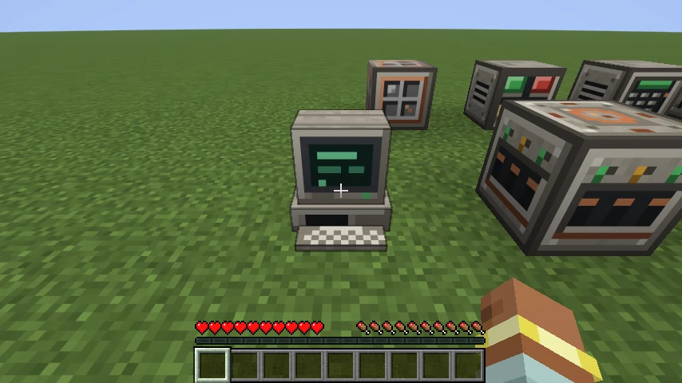
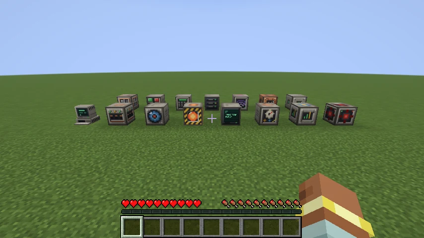

# FilaSignal

Programmable computers and hardware for Minecraft, scripted in **FilaScript**, a small language made for the job.

[](https://github.com/Venuss1337/filasignal/actions/workflows/build.yml)
[](https://github.com/Venuss1337/filasignal/releases/latest)
[](LICENSE)


**[Documentation](https://venuss1337.github.io/filasignal/)** ·
**[Download](https://github.com/Venuss1337/filasignal/releases/latest)** ·
**[First automation](https://venuss1337.github.io/filasignal/minecraft/getting-started/first-automation/)** ·
**[Learn FilaScript](https://venuss1337.github.io/filasignal/language/)**



## What it is

Place a Programmable Computer, link hardware to it (detectors, displays, alarms, redstone controllers, inventory
modules, weather stations, sensors, storage servers, access controllers, control panels, wireless bridges) and write
a program in the in-game editor. Programs react to events in the world, so a detector can sound an alarm, a control
panel can open a door, and a farm can report its stock on a screen.

- **FilaScript:** a readable event-driven language with functions, lists, dictionaries, classes, enums, JSON and
  persistent globals, and clear error messages with line and column.
- **Hardware with native events:** `on gate.entityEnter(entity)`, `on sky.rainStart()`, `on panel.buttonOne(player)`.
- **Autonomous devices:** put a Programmable Data Drive in a device and it runs its own program, no computer needed.
- **Networks and storage:** link devices with repeaters and wireless bridges; keep data on drives and Storage Servers.
- **Built-in editor and debugger:** highlighting, completion, starters, breakpoints, stepping and a live console.
- **Multiplayer-safe:** owners and trusted players, server-side checks on every action, and strict per-tick limits so
  programs cannot stall a server.
- **Survival-ready:** every block and item has a recipe and original textures.

## Example

```fsig
const gate = detectors.named("gate")
const siren = alarms.named("siren")

on gate.entityEnter(entity) {
    print(entity.name + " is at the gate!")
    siren.activate()
}
```

Name an Entity Detector `gate` and an Alarm Module `siren`, link both to a computer, and the alarm rings when someone
walks up. [Build it step by step](https://venuss1337.github.io/filasignal/minecraft/getting-started/first-automation/).

| | |
| --- | --- |
|  |  |

## Requirements

| | |
| --- | --- |
| Minecraft: Java Edition | 26.3 |
| Fabric Loader | 0.20.1 or newer |
| Fabric API | 0.166.2+26.3 or newer |
| Java | 25 or newer |

Install FilaSignal on the server and on every client that joins. It bundles the libraries it needs (LibGui and the
FilaScript core).

## Installation

1. Install [Fabric Loader](https://fabricmc.net/use/installer/) for Minecraft 26.3.
2. Download `filasignal-1.0.0+mc26.3.jar` from the [latest release](https://github.com/Venuss1337/filasignal/releases/latest)
   and [Fabric API](https://modrinth.com/mod/fabric-api) for 26.3.
3. Put both into the `mods` folder and start the game.

Server setup is in the [installation guide](https://venuss1337.github.io/filasignal/minecraft/getting-started/installation/).

## Standalone FilaScript

FilaScript runs without Minecraft. Download `filascript-cli-1.0.0.zip` from the release, unzip it and run
`bin/filascript-cli run examples/hello.fsig` (Java 25 required). See
[the language documentation](https://venuss1337.github.io/filasignal/language/).

## Development

```sh
git clone https://github.com/Venuss1337/filasignal.git
cd filasignal
./gradlew build                          # tests, server GameTests and the mod JAR
./gradlew :filasignal-fabric:runClient   # a development client
```

| Path | Contents |
| --- | --- |
| `filascript-core/` | The language: lexer, parser, resolver, interpreter, persistence, debugger. No Minecraft code. |
| `filascript-cli/` | The standalone command-line interpreter. |
| `filasignal-fabric/` | The Fabric mod: computers, hardware, networks, editor, GameTests. |
| `web/` | The documentation site (Astro + Starlight). |
| `docs/` | Architecture, design decisions, language specification and engineering notes. |
| `tools/` | Verification, benchmarks and asset generation. |

Start with [CONTRIBUTING.md](CONTRIBUTING.md) and the [architecture overview](docs/architecture/OVERVIEW.md).
Contributors using AI coding agents will find instructions in [AGENTS.md](AGENTS.md) and [CLAUDE.md](CLAUDE.md).

## License

FilaSignal is free software under the [GNU General Public License v3.0 only](LICENSE) (`GPL-3.0-only`). You may use,
modify and redistribute it, including commercially, as long as distributed versions keep the same license and make
their source available. Bundled libraries keep their own licenses; see [third-party notices](THIRD-PARTY-NOTICES.md).
Use of the project name is described in the [branding policy](docs/BRANDING.md).

FilaSignal was developed with the help of AI coding assistants. It is not affiliated with Mojang Studios or Microsoft.
